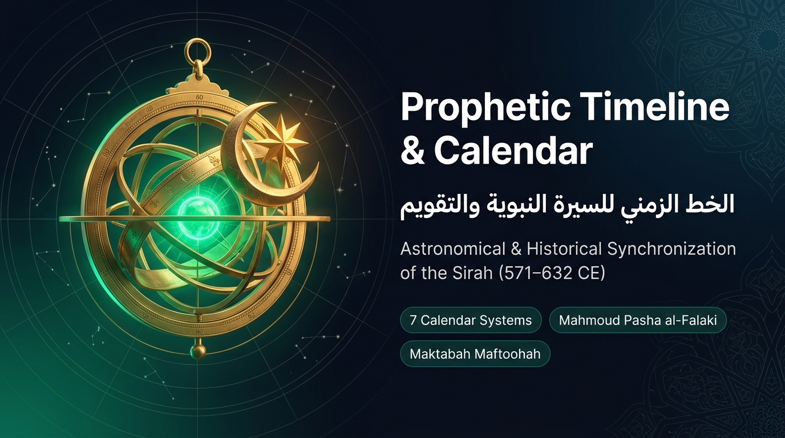
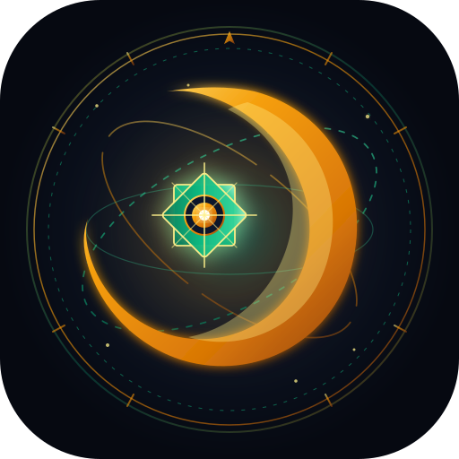

<div align="center">
  

  <br><br>

  

  # Prophetic Timeline & Calendar
  ### (الخط الزمني للسيرة النبوية والتقويم)

  <p align="center">
    <b>Penyelarasan Falak &amp; Sejarah Menurut Penyelidikan Mahmoud Pasha al-Falaki</b><br>
    <i>A Falaki-Grade Chronology &amp; Multi-Calendar Harmonization of the Sirah (571–632 CE)</i>
  </p>

  <p align="center">
    <a href="https://maktabah-maftoohah.github.io/prophetic-timeline/"></a>
    <a href="https://github.com/maktabah-maftoohah"></a>
    
    
  </p>
</div>

---

## 1. Pengenalan & Matlamat Aplikasi

**Prophetic Timeline & Calendar** ialah sebuah aplikasi visualisasi interaktif berasaskan web sifar-binaan (*zero-build vanilla ES6*) yang mempersembahkan kronologi sejarah dan peristiwa agung era kenabian bermula daripada zaman purba, Tahun Gajah (*‘Ām al-Fīl*), sehingga kewafatan Junjungan Mulia Nabi Muhammad ﷺ (571–632 Masihi).

Aplikasi ini dibina berasaskan kajian bersejarah ahli falak dan matematik Mesir abad ke-19, **Mahmoud Pasha al-Falaki** (Mahmoud-Bey, 1815–1885 M), yang diselaraskan merentasi 7 sistem penanggalan serentak.

---

## 2. Ciri-Ciri Utama Aplikasi

1. **📜 Garis Masa Interaktif ("Falak Chrono-Navigator" Timeline View)**:
   - **Pita Pengemudi Era Kenabian (*Sticky Minimap Scrubber*)**: Jalur navigasi pantas melekat di atas skrin dengan penunjuk kedudukan skrol (*scroll-spy needle*) dan mercu tanda interaktif (Purba, Tahun Gajah, Mawlid, Bi'thah, Hijrah, Fath Makkah, Gerhana, Wafat).
   - **Dwi-Mod Paparan (Aliran Naratif vs Skala Masa Proporsional)**: Mod proporsional di mana jarak menegak antara kad mencerminkan jurang hari dan tahun astronomi sebenar ($\Delta \text{JDN}$), menonjolkan perbezaan tempoh 40 tahun persediaan vs 10 tahun era Madinah.
   - **Pemeriksa Jarak Masa Astronomi (*Inline Time-Delta Inspector*)**: Memilih dan membandingkan mana-mana dua peristiwa merentasi 7 sistem kalendar dan menghitung jarak hari mutlak secara langsung.
   - **Penapis Cip Interaktif (*Interactive Filter Chips*)**: Penapisan pantas berbilang era (Semua, Paksi Falak, Zaman Purba, Tahun Gajah & Mawlid, Makkah, Madinah, Kewafatan).
   - **Garis Masa Berketepatan Hari (571–632 M)**: Kad peristiwa dengan penanda hari, jalur padanan 7 kalendar, lencana jarak hari dari hari kelahiran (*Mawlid*), serta garisan penyambung hari (*Day-Count Connectors*).

2. **📅 Paparan Kalendar Bulanan ("Google Calendar-Style" Month View)**:
   - Grid 7 hari seminggu dengan cip peristiwa.
   - Pemandu grid kalendar boleh ditukar:
     - **Taqwim Hijri (AH / BH)** (Pilihan Utama/Lalai).
     - **Tahun Gajah (*‘Ām al-Fīl*, 1–63)**.
     - **Masihi Julian** & **Masihi Gregorian**.
   - Lompat pantas ke peristiwa kemuncak (Tahun Gajah, Mawlid, Bi'thah, Hijrah, Gerhana, Haji Wada', Kewafatan).
   - Dialog perincian hari yang memaparkan 7 sistem kalendar bagi mana-mana hari terpilih.

3. **🗓️ Paparan Kalendar Tahunan (12-Month Year View)**:
   - Pandangan mata burung (*bird's-eye view*) 12 bulan mini dalam satu paparan.
   - Penunjuk titik kepadatan peristiwa. Klik mana-mana bulan untuk terus melompat ke paparan bulanan.

4. **🪐 Visualisasi Falak Interaktif (Astro Simulator)**:
   - **Simulator Fasa Bulan & Rukyah Hilal (Kriteria MABIMS & Odeh)**: Simulasi dinamik kedudukan hilal di ufuk barat waktu maghrib, mengira ketinggian ($0^\circ-15^\circ$), jarak lengkok/elongasi dari matahari ($0^\circ-25^\circ$), umur bulan ($1-48\text{ jam}$), dan peratusan cahaya sabit. Menguji kebolehnampakan secara langsung berasaskan Kriteria MABIMS Baharu (2021+: Ketinggian $\ge 3^\circ$, Elongasi $\ge 6.4^\circ$), MABIMS Tradisional, Kriteria Astronomi Antarabangsa Dr. Mohammad Odeh (Zon A/B/C/D), dan Had Fizikal Danjon ($7^\circ$). Dilengkapi 5 mercu tanda hilal agung era kenabian (Zulhijjah 10 H, Syawal 10 H, Mawlid 53 BH, Bi'thah 13 BH, Hijrah 1 H) dan hadis rukyah hilal Sahih al-Bukhari & Muslim.
   - **Simulator Gerhana Matahari di Madinah (27 Januari 632 M / 29 Syawal 10 H)**: Simulasi kanvas gerhana anulus (litupan 87% / 10.5 jari) pada pagi kewafatan putera Nabi ﷺ, Ibrahim, lengkap dengan hadis [Sahih al-Bukhari (No. 1043)](https://maktabah-maftoohah.github.io/sahih-al-bukhari/1043).
   - **Rajah Buruj Qiran Zuhal & Musytari (1 April 571 M)**: Paparan SVG buruj Scorpio (*al-Aqrab*) menunjukkan kedudukan Zuhal ($215^\circ 17'$) dan Musytari ($215^\circ 02'$) sebelum kelahiran Nabi ﷺ.

5. **📚 Pautan Hadis Kanonikal Bersepadu (Maktabah Maftoohah Corpus)**:
   - Modul `hadith-linker.js` menghubungkan secara automatik semua teks rujukan hadis ke pangkalan korpus digital Maktabah Maftoohah: *Sahih al-Bukhari*, *Sahih Muslim*, *Sunan Abi Dawud*, *Jami' at-Tirmidhi*, *Sunan an-Nasa'i*, *Sunan Ibn Majah*, *Musnad Ahmad*, dan *Muwatta Malik*.

6. **🔢 Kalkulator Jarak Hari Interaktif (Day-Count Calculator)**:
   - Pengguna boleh memilih mana-mana dua peristiwa sejarah untuk mengira jarak hari sebenar, kesetaraan tahun qamari ($354.367\text{ hari}$), dan tahun syamsi ($365.2422\text{ hari}$).

7. **🌐 Antara Muka Tiga Bahasa (BM / EN / AR)**:
   - **Bahasa Melayu** (Nomenklatur Islam Nusantara piawai) sebagai bahasa lalai.
   - **Bahasa Inggeris** (English) & **Bahasa Arab** (العربية) dengan tipografi khat Amiri dan sokongan RTL penuh.

8. **👤 Halaman Khas Profil Lengkap Mahmoud Pasha al-Falaki (`mahmoud-pasha.html`)**:
   - Biografi ilmiah lengkap pelopor falak moden dunia Arab (1815–1885 M).
   - Penjelasan 4 tunjang falak mutlak (Gerhana Madinah 632 M, Mawlid Isnin 9 Rabiulawal 571 M, Pemansuhan Sistem Nasi' 10 H, Qiran Zuhal & Musytari 571 M).
   - Jadual perbandingan saintifik: 9 Rabiulawal (Isnin) vs 12 Rabiulawal (Khamis).
   - Arkeoastronomi & sumbangan lain: Pemetaan Iskandariah Purba (1872), Ekspedisi Gerhana Dongola (1860), Kitab Kalkulus pertama bahasa Arab (1842), dan hidrologi Sungai Nil.
   - Garis masa hayat interaktif (1815–1885 M).
   - Senarai rujukan berwibawa & pautan terus ke manuskrip digital di Gallica (BnF), Internet Archive (PDF rasmi), Wikisource Arab, dan Wikimedia Commons.

---

## 3. Seni Bina & Invarian Organisasi

Sesuai dengan garis panduan `AGENTS.md` pertubuhan Maktabah Maftoohah:
* **Zero-Build Vanilla ES6**: Berfungsi secara *native* di pelayar moden tanpa perlukan kompilasi, bundler, atau kebergantungan runtime Node.js.
* **Laluan Relatif Penuh**: Semua aset diakses menggunakan `./css/...`, `./js/...`, `./data/...` supaya serasi 100% dengan pengehosan subpath GitHub Pages.
* **PWA & Offline First**: Fail `manifest.webmanifest` dan `sw.js` (Service Worker) membolehkan aplikasi dipasang di telefon pintar/komputer dan beroperasi tanpa sambungan internet.
* **Integriti Teks Suci**: Menggunakan teks Al-Quran dan matan hadis autentik tanpa sebarang janaan teks buatan.

---

## 4. Struktur Direktori

```
prophetic-timeline/
├── index.html                    # Kerangka utama aplikasi web
├── mahmoud-pasha.html            # Halaman profil lengkap & rujukan Mahmoud Pasha al-Falaki
├── manifest.webmanifest          # PWA Web App Manifest
├── sw.js                         # Service Worker (Cache luar talian)
├── README.md                     # Dokumentasi projek
├── css/
│   ├── main.css                  # Gaya asas, tema cerah/gelap, modal
│   ├── profile.css               # Gaya khas halaman profil Mahmoud Pasha
│   ├── timeline.css              # Gaya garis masa menegak & kad
│   ├── calendar.css              # Gaya grid kalendar bulanan & tahunan
│   └── visualizers.css           # Gaya kanvas simulator falak & kalkulator
├── docs/
│   └── astronomical-methodology.md# Dokumentasi kaedah astronomi & formula penukaran
├── js/
│   ├── app.js                    # Titik masuk modul JavaScript (ES6)
│   ├── profile.js                # Modul interaktif halaman profil (tema, bahasa, navigasi)
│   ├── core/
│   │   ├── calendar-engine.js    # Enjin matematik penukaran 7 sistem kalendar
│   │   ├── event-store.js        # Pengurus storan data & penapis peristiwa
│   │   ├── hadith-linker.js      # Pengurus pautan kanonikal korpus hadis bersepadu
│   │   └── i18n.js               # Pengurus terjemahan bahasa
│   ├── views/
│   │   ├── timeline-view.js      # Pengendali paparan garis masa
│   │   ├── calendar-month-view.js# Pengendali paparan kalendar bulanan
│   │   └── calendar-year-view.js # Pengendali paparan kalendar tahunan
│   ├── visualizers/
│   │   ├── moon-phase-sim.js     # Simulator fasa bulan & rukyah hilal (MABIMS & Odeh)
│   │   ├── eclipse-sim.js        # Simulator kanvas gerhana matahari 632 M
│   │   ├── conjunction-sim.js    # Rajah SVG buruj qiran Scorpio 571 M
│   │   └── day-calculator.js     # Kalkulator jarak hari interaktif
│   └── i18n/
│       ├── ms.js                 # Penterjemahan Bahasa Melayu (Lalai)
│       ├── en.js                 # Penterjemahan Bahasa Inggeris
│       └── ar.js                 # Penterjemahan Bahasa Arab
└── data/
    └── events.json               # Pangkalan data 25 peristiwa Mahmoud Pasha al-Falaki
```

---

## 5. Menjalankan Aplikasi Secara Tempatan

Anda boleh menjalankan aplikasi ini serta-merta menggunakan pelayan HTTP terbina dalam Python:

```bash
cd prophetic-timeline
python scripts/serve.py --port 8000
```

Buka pelayar web di:
```
http://localhost:8000
```

---

## 6. Identiti Visual & Aset Jenama (Branding Assets)

Aplikasi dan repositori ini dilengkapi dengan himpunan aset grafik beresolusi tinggi dan vektor (`SVG` & `PNG`) yang mengekalkan estetika warisan falak Islam moden (gabungan warna zamrud `#10b981`, emas astronomi `#f59e0b`, dan obsidian malam `#0b0f17`):

| Aset | Format & Saiz | Penerangan & Kegunaan | Pratonton / Fail |
| :--- | :--- | :--- | :--- |
| **GitHub Social Banner** | `PNG` (1376×768) & `SVG` (1280×640) | Sepanduk utama repositori, pratonton media sosial (OpenGraph), dan pengepala README. | [`assets/banner.png`](./assets/banner.png) • [`banner.svg`](./assets/banner.svg) |
| **GitHub Avatar** | `PNG` (1024×1024) & `SVG` (1024×1024) | Gambar profil GitHub / avatar organisasi, dilaraskan khas untuk pemotongan bulatan (*circular crop safe*). | [`assets/avatar.png`](./assets/avatar.png) • [`avatar.svg`](./assets/avatar.svg) |
| **Master Logo / Emblem** | `PNG` (1024×1024) & `SVG` (920×240) | Lambang astrolab, hilal, dan bintang 8 penjuru berserta khat tajuk penuh. | [`assets/logo.png`](./assets/logo.png) • [`logo.svg`](./assets/logo.svg) |
| **Logo Icon (Webapp Header & PWA)** | `SVG` & `PNG` (512×512, 192×192) | Ikon ringkas untuk bar navigasi laman web dan pemasangan Progressive Web App. | [`assets/logo-icon.svg`](./assets/logo-icon.svg) • [`data/icon.png`](./data/icon.png) |
| **Favicon Laman Web** | `ICO` & `PNG` (32×32, 16×16) | Ikon tab pelayar web untuk pelbagai peranti dan resolusi skrin. | [`favicon.ico`](./favicon.ico) • [`assets/favicon-32x32.png`](./assets/favicon-32x32.png) |

### 🛠️ Panduan Penggunaan di GitHub:
1. **GitHub Social Preview (Banner)**:
   - Pergi ke tetapan repositori: **Settings** > **General** > **Social preview**.
   - Klik **Edit** > **Upload an image...** dan pilih fail [`assets/banner.png`](./assets/banner.png) atau [`assets/github-banner.png`](./assets/github-banner.png).
2. **GitHub Avatar / Profile**:
   - Untuk profil organisasi atau akaun projek, muat naik fail [`assets/avatar.png`](./assets/avatar.png) atau [`assets/github-avatar.png`](./assets/github-avatar.png). Komposisi direka khas supaya tiada elemen terpotong dalam bulatan avatar GitHub.

